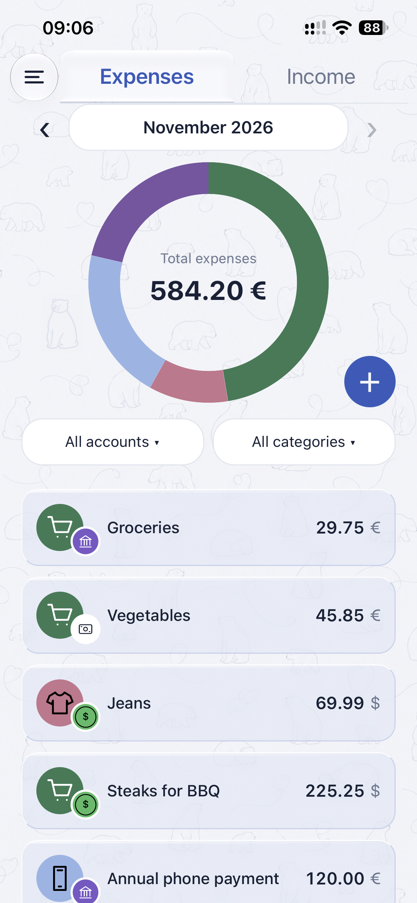
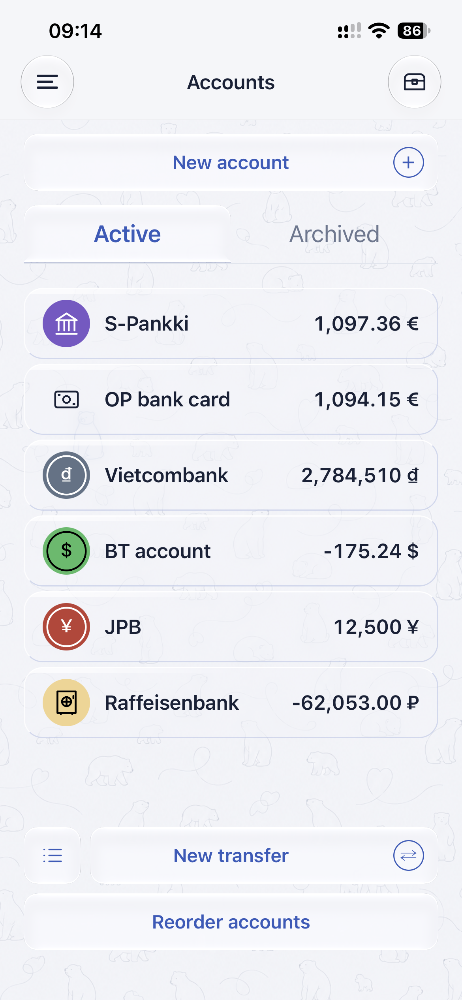
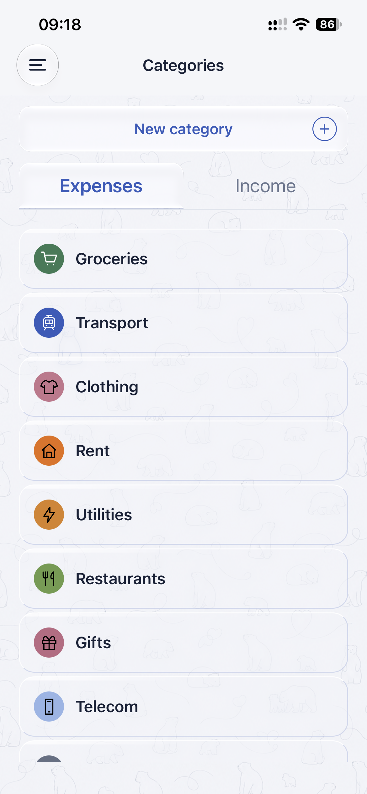
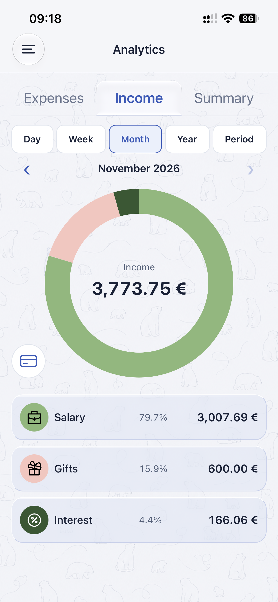
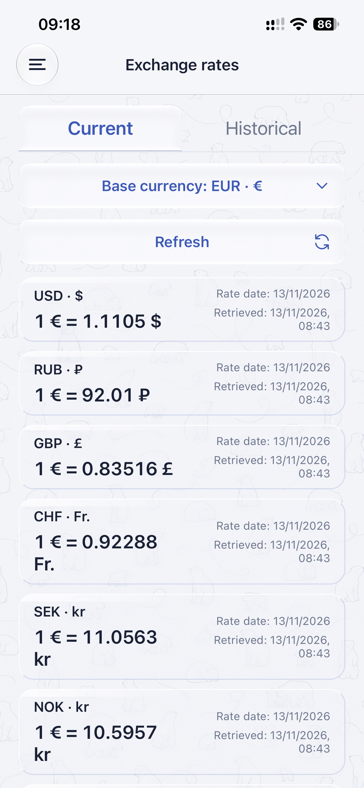

# Family Budget Mobile

A mobile app for tracking income, expenses, account balances, and transfers across multiple currencies. Built with Expo, React Native, and TypeScript.

This repository contains the mobile client. The [Family Budget Backend](https://github.com/Mikhail-Nekrasov/Family_budget_backend) is maintained separately and provides current and historical exchange rates.

## Screenshots

| **Main** | **Accounts** | **Categories** |
| :---: | :---: | :---: |
|  |  |  |
| Browse income and expenses by period, account, and category. | Manage balances, account order, and transfers. | Organize income and expenses with custom categories and icons. |

| **Analytics** | **Exchange rates** |
| :---: | :---: |
|  |  |
| Explore spending, income, and savings with interactive charts. | Browse current and historical exchange rates. |

## Project status

Active development. Accounts, categories, transactions, and transfers are stored locally on the device in SQLite. The app uses the backend for exchange rates and keeps a local cache. Uncached rates require a network connection. Shared family access and cross-device synchronization are not implemented in the mobile client.

## Features

- Record and edit income and expenses, with a built-in calculator for entering amounts.
- Organize transactions by account and category, and browse them by day, week, month, year, or a custom date range.
- Manage accounts in different currencies, reorder or archive them, and hide selected accounts from the default balance overview.
- Transfer money between accounts, including accounts in different currencies, and review, edit, or delete past transfers.
- View account balances and spending, income, and savings in interactive charts. Filter analytics by account and open the transactions behind a category total.
- Browse current and historical exchange rates and choose a primary currency for converted totals.
- Use the app in English, Finnish, or Russian, with light and dark themes.

## Technology stack

| Area | Technology |
| --- | --- |
| Mobile UI | React Native, Expo, TypeScript |
| Navigation | Expo Router |
| Local storage | Expo SQLite |
| Charts and animation | React Native SVG, React Native Reanimated |
| Exchange rates | REST API provided by Family Budget Backend |

## Run locally

Install Node.js and npm. Use Expo Go on a physical device with a compatible Expo SDK, or use a development build.

```bash
git clone https://github.com/Mikhail-Nekrasov/Family_budget_mobile.git
cd Family_budget_mobile
npm ci
npx expo start
```

Scan the QR code to open the app on a device, or use the Expo terminal shortcuts to open an installed iOS Simulator or Android emulator.

### Exchange rate API

The app uses the default backend configured in `src/config/api.ts`. To use another server, create a `.env.local` file at the project root:

```dotenv
EXPO_PUBLIC_API_URL=http://192.168.1.100:8080
```

Replace the example IP address with the LAN address of the computer running the backend when testing on a physical phone. On the phone, `localhost` refers to the phone itself. See the [backend README](https://github.com/Mikhail-Nekrasov/Family_budget_backend#readme) for server setup.

## Development checks

```bash
npm run lint
npx tsc --noEmit
```

## License and third-party notices

The original Family Budget Mobile code is proprietary and is not offered under an open-source license.
Third-party dependencies remain subject to their respective licenses.
