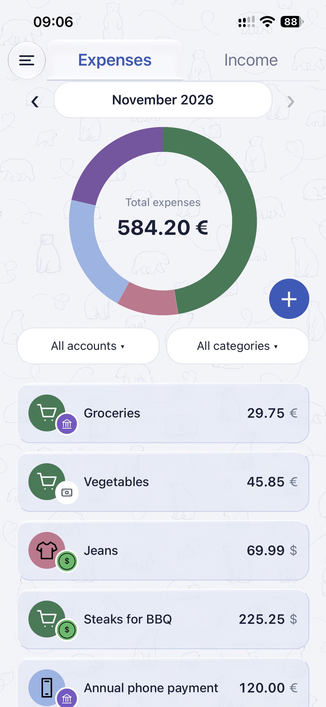
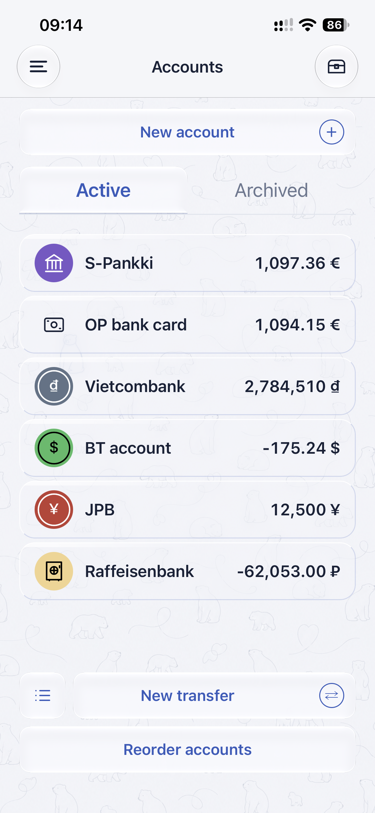
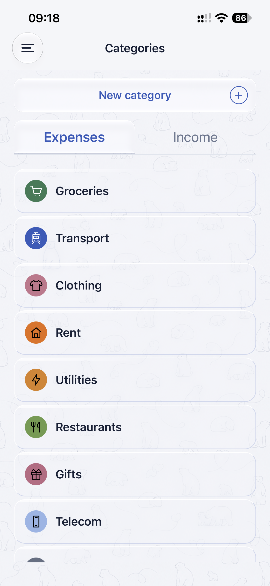
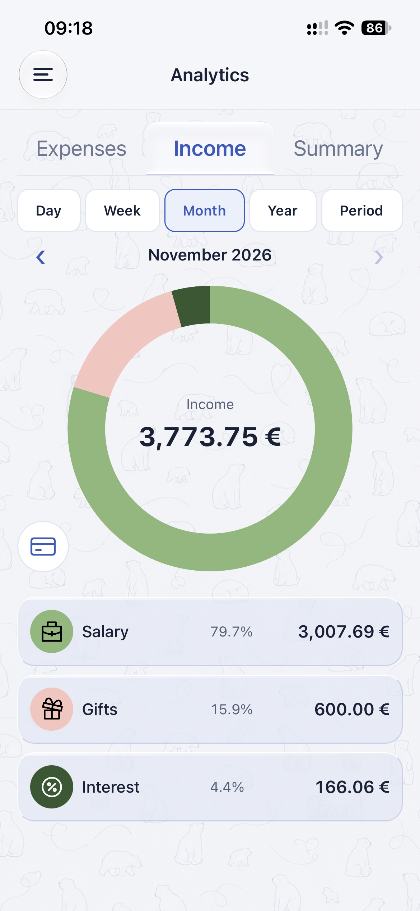
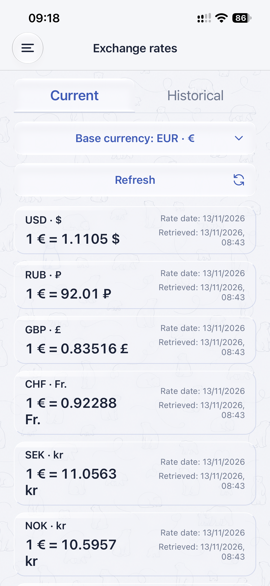

# Family Budget Mobile

A mobile app for tracking income, expenses, account balances, and transfers across multiple currencies. Built with Expo, React Native, and TypeScript.

This repository contains the mobile client. The separately maintained [Family Budget Backend](https://github.com/Mikhail-Nekrasov/Family_budget_backend) handles user registration and authentication, stores each user's budget data, and supports bidirectional synchronization of accounts, categories, income, expenses, transfers, and budget appearance preferences. It also exposes cached current and historical exchange rates obtained from [Frankfurter](https://frankfurter.dev/), which is the external rate provider, while the backend is the mobile client's API for both budget data and exchange rates.

## Screenshots

| **Main** | **Accounts** | **Categories** |
| :---: | :---: | :---: |
|  |  |  |
| Browse income and expenses by period, account, and category. | Manage balances, account order, and transfers. | Organize income and expenses with custom categories and icons. |

| **Analytics** | **Exchange rates** |
| :---: | :---: |
|  |  |
| Explore spending, income, and savings with interactive charts. | Browse current and historical exchange rates. |

## Project status

The project was completed for the Mobile Programming course at **Commit 35**. This commit marks the course submission; subsequent commits represent continued development beyond the course requirements.

The current version is a functional prototype tested on a physical iPhone and an iOS simulator. Further development will focus on:

- Improving synchronization reliability and expanding automated tests for concurrent changes across devices.
- Introducing groups that allow multiple users to manage shared financial accounts, with appropriate access controls.
- Adding Sign in with Apple.
- Refining the user interface, accessibility, and overall user experience.
- Preparing the application for a public release on the App Store.

## Features

### Budget management

- Create, edit, and delete income and expenses, with a built-in calculator for entering amounts.
- Browse operations by day, week, month, year, all time, or a custom date range, and filter them by account and category.
- Manage accounts in different currencies, reorder or archive them, and hide selected accounts from the default balance overview.
- Transfer money between accounts, including accounts in different currencies, and review, edit, or delete past transfers.
- Customize account and category icons and colors. Reorder income and expense categories separately.
- Keep financial changes consistent through SQLite transactions and represent monetary values in the smallest units of each currency.

### Analytics and exchange rates

- View account balances and spending, income, and savings using interactive charts.
- Filter analytics by account and open the transactions behind a category total.
- Browse current and historical exchange rates and choose a primary currency for converted totals.
- Cache retrieved rates locally. Saved rates remain available offline; uncached rates require an internet connection.

### Interface and languages

- Use the app in **English, Finnish, Russian, French, Spanish, or Vietnamese**.
- Display standard category names, dates, and monetary values according to the selected language and locale.
- Switch between light and dark themes, with custom illustrated backgrounds and vector icons.
- Use native Apple Liquid Glass controls where supported, with alternative rendering for components that provide a fallback.
- Navigate through a side menu with larger labels and custom icons.
- Use consistent form headers with back controls and fixed action areas in budget entity forms.

### Offline use and synchronization

- Save changes locally and keep a persistent upload queue so interrupted requests can be retried.
- Synchronize automatically after local budget changes, after sign-in, when the app returns to the foreground, and when connectivity returns.
- Manually request a synchronization cycle using **Refresh from server** in Settings.
- Load an existing server budget when signing in on a new device.
- Synchronize account and category colors, category icons, account visibility, and account/category ordering between devices.
- Update local screens after server data has been applied.

Synchronization is event-driven rather than continuous polling. Server-side changes made on another device are retrieved on the next synchronization cycle; they are not pushed instantly to an idle client. Automatic work runs while the app is in the foreground, and temporary failures are retried with increasing delays.

### Conflict resolution

- Use version checks to detect concurrent changes and automatically merge independent field edits where possible.
- Preserve changes when they conflict with deletion, including restoring missing account or category dependencies needed by queued operations.
- Keep unresolved conflicts in local storage and continue processing independent operations.
- Open **Synchronization** from Settings or from the conflict notification.
- Compare differing local and server values side by side, including icon previews and colors, and choose the version to apply.
- Identify conflicts by entity type and name, with dates for entries and transfers and source/destination accounts for transfers.

Conflict handling covers accounts, categories, income, expenses, transfers, and synchronized appearance preferences.

## Architecture and backend

The mobile client uses SQLite as its working database. Budget mutations update local data and queue commands for the server. The synchronization layer sends pending commands, downloads server changes, and applies the results locally. Stable identifiers, stored requests, and idempotent server commands support retries without applying the same financial operation twice.

The backend is responsible for authentication, ownership checks, server-side persistence, financial updates, version validation, and synchronization endpoints. Mobile session credentials are stored using Expo SecureStore. The client keeps separate local databases for different user profiles.

Exchange rates follow a separate data path:

**Frankfurter → Family Budget Backend → mobile client's local rate cache**

The client calls the backend's `/api/exchange-rates` and `/api/exchange-rates/history` endpoints and not calling Frankfurter directly. Exchange rates are external reference data; the backend also manages the application's own budget records and synchronization state.

## Technology stack

| Area | Technology |
| --- | --- |
| Mobile UI | React Native, Expo, TypeScript |
| Navigation | Expo Router |
| Local storage | Expo SQLite; AsyncStorage for local settings |
| Authentication storage | Expo SecureStore |
| Identifiers and hashing | Expo Crypto |
| Connectivity | Expo Network and React Native AppState |
| Charts and animation | React Native SVG, React Native Reanimated |
| Drag-and-drop ordering | React Native Reorderable List |
| Glass and blur effects | Expo GlassEffect, Expo Blur |
| Date and time selection | Expo UI |
| Localization | Typed translation dictionaries and JavaScript Intl |
| Synchronization | Custom SQLite-backed queue, version checks, and conflict resolution over REST |
| Backend | Separate Spring Boot application with PostgreSQL persistence |
| Exchange rate source | Frankfurter, accessed through Family Budget Backend |
| Automated tests | Node.js built-in test runner |

## Run locally

Use Node.js 22.13 or newer and npm. Run the app with a compatible Expo Go version, or use a native development build when required by the installed modules.

```bash
git clone https://github.com/Mikhail-Nekrasov/Family_budget_mobile.git
cd Family_budget_mobile
npm ci
npx expo start
```

Scan the QR code to open the app on a device, or use the Expo terminal shortcuts to open an installed iOS Simulator or Android emulator. Connect to the internet to register or sign in and initialize the local budget.

### Backend configuration

The app uses the default backend configured in `src/config/api.ts` for authentication, budget synchronization, preferences, and exchange rates. To use another server, create a `.env.local` file at the project root:

```dotenv
EXPO_PUBLIC_API_URL=http://192.168.1.100:8080
```

Replace the example IP address with the LAN address of the computer running the backend when testing on a physical phone. On the phone, `localhost` refers to the phone itself. See the [backend README](https://github.com/Mikhail-Nekrasov/Family_budget_backend#readme) for server setup. Restart the development server after changing the environment variable; rebuild an installed Release app to include the new value.

### Standalone iOS build

A Release build includes the JavaScript bundle and runs without Expo Go or a development server on the laptop.

On a Mac with compatible Xcode and CocoaPods installed:

1. Set a unique `expo.ios.bundleIdentifier` in `app.json` and configure the app icon there.
2. Generate the iOS project and install its native dependencies:

   ```bash
   npx expo prebuild --platform ios
   open ios/*.xcworkspace
   ```

3. In Xcode, select the application target, enable automatic signing, and choose the appropriate team under **Signing & Capabilities**.
4. Select the connected iPhone and set **Product → Scheme → Edit Scheme → Run → Build Configuration** to **Release**.
5. Build and install with **Run** (`Cmd+R`). Device trust and Developer Mode may need to be enabled on the iPhone.

The generated `ios` directory is excluded from version control. Regenerating the native project can require selecting the signing team again. An installed standalone app has separate local storage from Expo Go; synchronize the old installation before switching and sign in to download its server data.

## Development checks

```bash
npx tsc --noEmit
npm run lint
npm run test:sync
```

The synchronization regression tests cover entity conflicts, retries, restoration of dependencies, balance handling, independent field merges, and synchronization of budget appearance and ordering.

## License and third-party notices

The original Family Budget Mobile code is proprietary and is not offered under an open-source license.
Third-party dependencies remain subject to their respective licenses.

## Use of Artificial Intelligence

ChatGPT was used throughout the development of this project, including: 
- discussing architecture and synchronization rules, 
- reviewing code,
- preparing automated tests,
- troubleshooting build issues, 
- drafting translations,
- creating visual assets.

As the author of this project, I defined the requirements, evaluated AI-generated suggestions, applied and revised changes, and tested the application on a physical iPhone and an iOS simulator. I take responsibility for the submitted project and its behavior.

Copyright (c) 2026 Mikhail Nekrasov. All rights reserved.
See [LICENSE](./LICENSE) for terms of use.